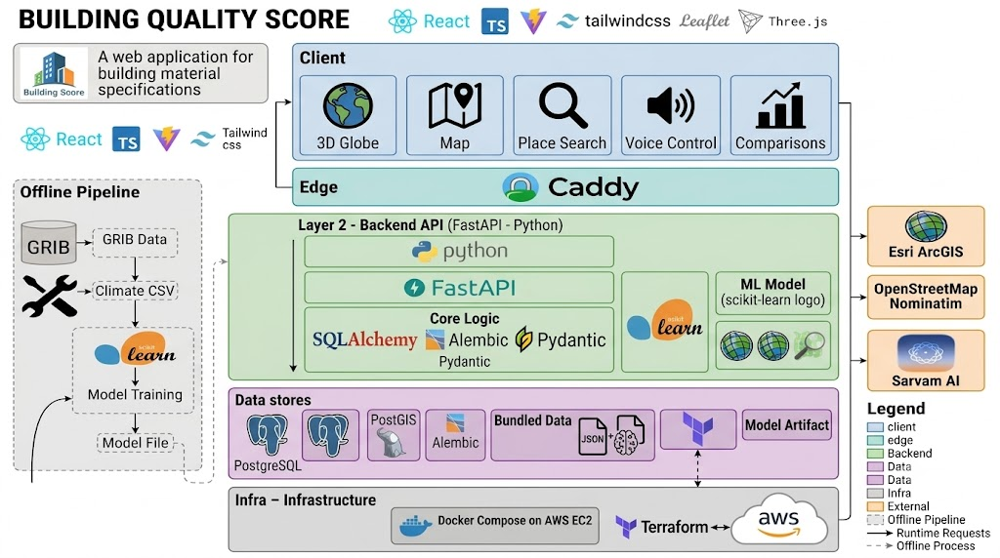
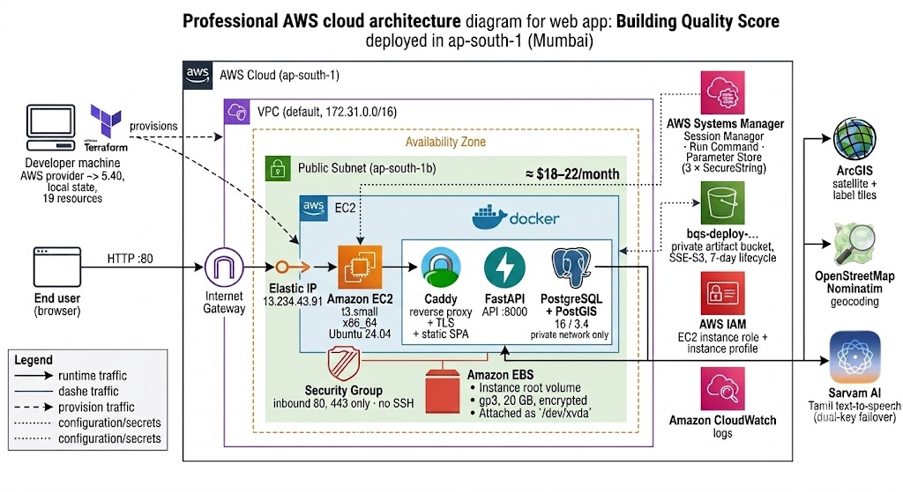

<div align="center">

# 🏗️ CLIENS

**Score a building's material specification against measured climate,
check it against IS 456:2000, and estimate how long it will last.**

Built by **Team Zenovators** for the **Tech For Good (Build with AI)** hackathon

🌐 **Live:** http://13.234.43.91

</div>

---

## Architecture

### Overall Architecture



### Cloud Architecture



The [target architecture](docs/images/architecture-target.png), including the planned
Earth Engine, Gemini and IMD integrations that are not built yet, is in
[`docs/`](docs/README.md).


---

## Team

**Team name:** Zenovators
**Hackathon:** Tech For Good — Build with AI
**Repository:** https://github.com/Build-with-AI-Code-for-Communities/cities-team-263-zenovators

| Name |
| --- |
| **Naveen** |
| **Suman** |
| **Surjune** |
| **Gowdham Karthik** |

---

## Table of Contents

1. [The Problem](#1-the-problem)
2. [What CLIENS Does](#2-what-cliens-does)
3. [Tech Stack](#3-tech-stack)
4. [The Data](#4-the-data)
5. [The Scoring Engine](#5-the-scoring-engine)
6. [Service Life Estimate](#6-service-life-estimate)
7. [Tamil Voice Narration](#7-tamil-voice-narration)
8. [Running Locally](#8-running-locally)
9. [Deployment](#9-deployment)
10. [Testing](#10-testing)
11. [Honesty & Known Limitations](#11-honesty--known-limitations)
12. [Proof of Work](#12-proof-of-work)

---

## 1. The Problem

Buildings in India are routinely specified with a generic concrete mix, regardless
of where they are built. A mix that lasts fifty years inland can corrode in fifteen
near the coast, because humidity, salt and wet–dry cycling drive reinforcement
corrosion at completely different rates.

**IS 456:2000** already accounts for this — it sorts structures into *exposure
classes* and sets a different minimum grade, cement content and water/cement ratio
for each. But applying it correctly means knowing your site's actual climate, and
most small builders don't have that.

CLIENS closes that gap: **draw your plot, and it tells you what the code requires
there and what your specification is actually worth.**

---

## 2. What CLIENS Does

A five-step flow:

| Step | What happens |
| --- | --- |
| **1 · Location** | Plot your site on a 3D satellite globe or a flat satellite map. Click each corner to outline the plot; the area is computed by PostGIS and saved. |
| **2 · Exposure** | Say how the concrete sits — enclosed, sheltered, exposed, buried or tidal — and which member it is: slab, beam, column or footing. |
| **3 · Approach** | Score *your* specification, or ask for a recommended one. |
| **4 · Materials** | Concrete grade, cement content and type, water/cement ratio, **nominal cover**, walling material. |
| **5 · Score** | A 0–100 score, every compliance check, an estimated service life, and the specification we'd recommend instead. |

Also included:

- **Tamil voice narration** of every question and option, and of the final result
- **Downloadable PDF report** to hand to a contractor, with the code clause behind each item
- **Address / PIN-code search** to find your site quickly

---

## 3. Tech Stack

### Frontend
`React 19` · `TypeScript (strict)` · `Vite` · `Tailwind CSS v4` · `React Router` ·
`Motion` · `Three.js / react-globe.gl` (3D globe) · `Leaflet` (flat satellite map)

### Backend
`Python 3.12` · `FastAPI` · `Pydantic v2` · `SQLAlchemy 2.0 (async)` · `Alembic` ·
`Shapely` · `Pillow` · `structlog` · `httpx`

### Data & ML
`PostgreSQL 16` + `PostGIS 3.4` · `scikit-learn 1.6` · `pandas` · `NumPy` ·
`ecCodes` (GRIB decoding) · `ReportLab` (PDF)

### Infrastructure
`Docker` + `Docker Compose` · `Caddy` (TLS + reverse proxy) · `Terraform` ·
`AWS EC2 / S3 / SSM / IAM`

### Third-party services
`Esri ArcGIS` (satellite imagery) · `OpenStreetMap Nominatim` (geocoding) ·
`Sarvam AI` (Tamil text-to-speech)

---

## 4. The Data

Every climate figure in CLIENS traces back to a single **ECMWF ERA5 reanalysis
GRIB file** — real measured atmospheric data, not a forecast and not a model output.

| | |
| --- | --- |
| **Source** | ECMWF ERA5 reanalysis (`data.grib`, 129 MB) |
| **Period** | 2016-01-01 → 2026-08-03 |
| **Grid** | 0.25° ≈ **27 km cells** |
| **Districts** | **37** with a measured profile |

### Offline pipeline

```
data.grib (129 MB)
   └─> grib_to_csv.py            decode 112,172 GRIB messages via ecCodes
        └─> climate CSV           143,116 rows
             └─> build_district_profiles.py
                  └─> district_climate_profiles.json   ← 37 districts, ships with the app
                       └─> train_quality_score.py
                            └─> quality_score_*.pkl    ← the model
```

The GRIB file itself is **not deployed** — only the small derived JSON and the
model artifact ship with the application.

Per district we derive: mean relative humidity, wet-hours fraction, wet/dry cycles
per year, mean and peak temperature, peak wind gust, soil moisture, and distance
to coast (computed from the land/sea mask in the sea-surface-temperature field).

---

## 5. The Scoring Engine

A deterministic rules engine sets the score; an ML model estimates the same score as a cross-check.

**1. Rules engine — `services/rules_engine.py`**
Classifies the IS 456 exposure class from how the element sits, following
Table 3 situation by situation: rain, wetting and drying and severe condensation
escalate only an *exposed* surface, and distance to the coast escalates each
situation as Table 3 words it (a sheltered element in coastal air is Moderate, an
exposed one Severe, one in spray reach Very Severe). Then checks the
proposed mix against **IS 456 Table 5** minimums (concrete grade, cement content,
maximum water/cement ratio), the **nominal cover** against **IS 456 Table 16** raised
by **clause 26.4.2** for the member (columns at least 40 mm, footings at least
50 mm), and walling suitability. Every finding cites its standard.

**What it is not.** This scores the *durability of one concrete element* for the
environment it sits in — which IS 456 sets per element, independent of how many
storeys the building has. It is **not** a structural or hazard-loss assessment:
it knows nothing of storeys, structural system, loads, plinth height or seismic
zone, so it cannot say whether a building will stand, flood or remain insurable.

**2. ML model — `GradientBoostingRegressor` (cross-check)**

| Metric | Value |
| --- | --- |
| R² | **0.9992** |
| MAE | **0.50** (on a 0–100 score) |
| Training samples | 69,619 |
| Test samples | 17,405 |
| Seed | 20231204 (fixed — scoring is deterministic) |

Top feature importances: `exposure_severity` 0.336 · `nominal_cover_mm` 0.220 ·
`required_cover_mm` 0.175 · `grade_mpa` 0.135 · `water_cement_ratio` 0.061

Measured against the rules score over 30,000 sampled specifications across every
district, situation, member, cover, walling and cement type, the model is within
0.45 points on average (1.4 at the 95th percentile, 2.4 at the 99th, 6.3 at worst).

**Why the headline is the rules score, not the model.** A tree ensemble trained on a
grid of values is a staircase between and beyond its training points. Sweeping one
input at a time showed it: every w/c from 0.58 to 0.70 scored an identical 66.9
while the rules fell to 56.0, and 45 mm of cover scored *below* 40 mm. The rules
score is exact, continuous and monotone in every input, so it is what the page,
the comparison and the PDF report; the model's estimate is shown beside it. Training and inference build features through one shared function,
`app/ml/quality_score.build_features`. Retrain with `npm run train:models`.

> **What this model is.** It is trained on **scenarios labelled by the rules
> engine**, not on observed building outcomes. No dataset exists that records
> "this building was specified like that and lasted N years." The model is a
> smooth interpolator over a deterministic rule set — it is **not evidence about
> real building survival**, and we don't present it as such.

---

## 6. Service Life Estimate

The results page shows an estimated service life for both the proposed and the
recommended specification.

**How it's derived** — anchored on the **50-year design life** the IS 456
durability provisions are written to deliver. A specification sitting exactly on
its exposure class's limits returns exactly 50 years. From there:

- **Cover** dominates. Corrosion starts once chlorides or the carbonation front
  cross the cover, and both advance with the square root of time (Fick's second
  law; `x = K√t`), so the time to cross a cover grows with its **square**: life
  scales as `(provided ÷ required cover)²`. Halving the cover quarters the time.
- **Water/cement ratio** sets how fast that ingress happens. The diffusion
  coefficient rises roughly exponentially with w/c, so life also scales as
  `exp(k × (required − provided))`. The exponent used is at the conservative end
  of the published range *(fib Bulletin 34; Papadakis, Vayenas & Fardis, ACI
  Materials Journal 88(2), 1991)*.
- **Falling short** of the minimum grade or cement content applies a further
  reduction, because the 50-year target's assumptions no longer hold.

Reported as a **range**, never a single year — two structures built to identical
specifications diverge by decades on workmanship and as-built cover alone.

> This answers *"how does this specification compare to one the code says lasts
> 50 years"* — **not** *"when will this building fall down."*

---

## 7. Tamil Voice Narration

Every question and **every option** is read aloud in Tamil, so a user can listen
instead of read and then choose for themselves. The voice explains; it never
selects.

- **Sarvam AI**, model `bulbul:v3`, speaker `kavitha` (verified against the live
  API — the model's speaker list differs from the general docs list)
- **Dual API keys with automatic failover.** On the first response indicating a
  spent key (HTTP 429/402/403) it switches immediately and stays switched, so the
  user hears no gap. A 400 is *not* retried on the second key — that's our bug,
  and retrying would burn a second quota for the same error.
- Long narrations are split on sentence boundaries (the API caps at 2,500
  characters) and joined server-side into one audio file, so playback is continuous.
- **Fully optional.** With no keys configured the Listen buttons simply don't
  appear and every question stays usable as text.

---

## 8. Running Locally

**Prerequisites:** Node 20+, Python 3.12, Docker

```bash
# 1. Database
npm run db:up

# 2. Configuration
cp .env.example .env        # Sarvam keys optional

# 3. Backend
npm run db:migrate
npm run db:seed
npm run dev:backend         # http://localhost:8010

# 4. Frontend (new terminal)
npm run dev:frontend        # http://localhost:5173
```

### Production mode on your machine

Runs the same three containers as the server — the built API image, PostGIS and
Caddy serving the compiled frontend — with no dev servers or reloaders:

```bash
cp .env.example .env        # if you have not already
npm run prod:up             # builds everything; open http://localhost
npm run prod:logs           # follow the logs
npm run prod:down           # stop (data is kept)
```

It uses its own Compose project and volumes, so it never touches the dev
database. Port 80 must be free.

---

## 9. Deployment

### Google Cloud (primary) — [`infra/gcp/`](infra/gcp/)

One command after the human-only steps (`gcloud auth login`, `gcloud auth
application-default login`, billing enabled, project registered for Earth Engine):

```bash
PROJECT_ID=your-project deploy/gcp/deploy.sh   # bootstrap → secrets → build → apply → verify
```

| Piece | Service |
| --- | --- |
| Frontend (Caddy: SPA + `/api` proxy) | Cloud Run `cliens-web`, public |
| Backend (FastAPI) | Cloud Run `cliens-api`, **ingress internal-only** — reachable only through the frontend over Direct VPC egress |
| Database | Cloud SQL PostgreSQL 16, **private IP only**; PostGIS created by the backend's entrypoint |
| Network | VPC + subnet with Private Google Access, private services access peering |
| Secrets | Secret Manager. The DB password is a Terraform `random_password`; API keys go from your local `.env` to Secret Manager over stdin and never touch Terraform state |
| Images | Cloud Build (dedicated service account) → Artifact Registry, tagged by git commit, auto-cleaned |
| Identity | One service account per workload, least privilege; Earth Engine via the backend's own identity (ADC) — **no key file exists in the deployment** |
| Observability | Cloud Logging with severity + per-request trace, uptime check on `/api/health/ready`, alerts on downtime and 5xx rate, a log metric for rejected explanations, request logs exported to BigQuery |

State lives in a versioned GCS bucket (`<project>-tfstate`) that the script creates
before `terraform init`. Each step can also be run alone, e.g.
`deploy/gcp/deploy.sh build`.

### AWS (alternative) — [`infra/aws/`](infra/aws/)

Fully automated with **Terraform** — nothing is created by hand in the AWS console,
and there is no SSH key to manage.

```bash
cp infra/aws/terraform.tfvars.example infra/aws/terraform.tfvars   # fill in secrets
terraform -chdir=infra/aws init
terraform -chdir=infra/aws apply  # creates 19 AWS resources
bash deploy/deploy.sh             # builds, uploads, starts — prints the URL
```

**What runs:** a single **EC2 t3.small** in `ap-south-1` running Docker Compose —
Caddy (TLS + static SPA + reverse proxy), the FastAPI backend, and
PostgreSQL/PostGIS on a private bridge network with no published port.

**Secrets** live in **SSM Parameter Store** as SecureString and are pulled at boot
by the instance's IAM role — never baked into an image or passed through user data.
**Deploy artifacts** go via a private **S3** bucket; the instance pulls them using
its own role, so no credentials travel with them. Shell access is **SSM Session
Manager** — no open port 22.

**Cost:** ≈ **$18–22/month**

Full detail, including what this setup deliberately does *not* do, is in
[`deploy/README.md`](deploy/README.md).

---

## 10. Testing

```bash
npm run test:all      # lint + typecheck + API type drift + backend + frontend
```

| | |
| --- | --- |
| Backend tests | **386** |
| Frontend tests | **17** |
| Type checking | `mypy --strict` clean · `tsc --strict` clean |
| Linting | `ruff` + `black` clean · `eslint` clean |
| API contract | `npm run check:types` fails if the committed frontend types differ from the backend's OpenAPI spec |

`npm run smoke` walks the live API end to end against a running backend (readiness,
scoring with cover checks, area scoring, the PDF, and the out-of-coverage refusal).

Tests never make real network calls — every external client is mocked with
`respx`. Integration tests run against a real PostGIS database (`npm run db:up`),
so a broken extension or schema drift fails the suite rather than only failing in
production. Unit tests that never touch the database run without it.

---

## 11. Honesty & Known Limitations

We would rather state these plainly than have them found.

**The climate grid is 27 km.** A boundary drawn around one building and one drawn
around the whole block resolve to the same reading. Deep satellite zoom helps you
*find* your plot; it does not make the score more precise.

**Interpolated readings are labelled as such.** If your outline contains no
measured grid cell, the climate is inverse-distance weighted from up to four real
neighbours within 85 km, and the result says so and names the cells. **Beyond that
radius the request is refused** — there is no neighbouring evidence, so any number
would be invention rather than interpolation.

**The score is code compliance, not a failure prediction.** It measures how a
specification compares to IS 456 for the measured climate. It is not a structural
analysis and does not consider foundations, seismic design, or workmanship.

**The ML model learned a rule set, not reality.** See §5.

**Cover is checked as specified, not as built.** On site, cover routinely comes
out thinner than drawn, and service life goes with its square — so the estimate
is only as good as the cover actually achieved. The Table 16 notes allowing 5 mm
less in some cases are not applied (the check errs safe), and the column rule
that cover must also be at least the bar diameter is not checked, because bar
size is not an input.

**Legacy tables remain.** The database still carries the `scores` and `reports`
tables from the abandoned damage model. Nothing reads or writes them; dropping
them needs a migration and is left as a deliberate, separate change.

**The model's training range is narrower than the form's.** It was trained on
cement contents of 260–380 kg/m³ and water/cement ratios of 0.35–0.60, while the
form accepts 100–800 kg/m³ and 0.30–0.70. Outside the trained range the headline
score is an extrapolation; the rules score and every compliance finding shown
beside it are still exact. Grades (M15–M45), cement types (OPC, PPC, PSC) and
walling materials outside what the model and knowledge base know are rejected
outright. Retraining over the full form range would close this.

**Deep satellite zoom depends on the Mapbox account.** When Mapbox rejects the
token (revoked, URL-restricted, or the account's tile access is blocked), the map
detects it, caps zoom at Esri's level 19 and credits Esri, rather than showing
placeholder tiles. Restoring zoom 20–22 needs the Mapbox account fixed.

**Coverage is Tamil Nadu only** — 37 districts, bounded by the source GRIB extent
(8.25–13.0°N, 76.75–80.0°E). Anywhere outside is refused, not guessed.

**The AWS deployment is single-instance.** No horizontal scaling (caches are
per-process), no automated database backups, and the instance is a single point
of failure. The GCP deployment scales and backs up, but its caches and rate
limiter are still per-instance, so limits apply per instance, not globally.

**Cloud SQL accepts unencrypted connections inside the VPC.** It has no public IP
and traffic stays on Google's private peering, but TLS is not enforced: doing so
needs driver-specific options in both connection URLs (asyncpg and psycopg spell
them differently).

**The climate outlook is slow the first time.** An Earth Engine CMIP6 outlook for a
new place takes 25–40 s; repeats within ~1 km are served from cache. It is context
only and never changes the score.

**Explanations depend on Gemini being up.** When Gemini fails, or writes a figure
the engine did not compute, the explanation is refused with an error rather than
shown; the score and every finding are unaffected.

**CLIENS is not a substitute for a licensed engineer.** It is a decision-support tool.

---

## 12. Proof of Work

This repository is the documentation and the proof of work for our submission.

| Evidence | Where |
| --- | --- |
| Live deployment | http://13.234.43.91 |
| Infrastructure as code | [`infra/gcp/`](infra/gcp/) (Google Cloud) and [`infra/aws/`](infra/aws/) — zero console clicks |
| Deployment pipeline | [`deploy/`](deploy/) |
| Offline data pipeline | [`ml/`](ml/) — GRIB → CSV → district profiles → model |
| Backend | [`backend/app/`](backend/app/) — strict `routes → services → repositories → core` layering |
| Frontend | [`frontend/src/`](frontend/src/) |
| Test suite | 386 backend + 17 frontend, all passing |
| Engineering conventions | [`CLAUDE.md`](CLAUDE.md) |
| Commit history | Every architectural decision and bug fix is recorded in the log |

**Verified live in production:** PostGIS 3.4.3 · 14 materials seeded · model loaded ·
scoring · polygon persistence · map tiles · PDF report generation.

---

<div align="center">

**CLIENS** · Team Zenovators · Tech For Good (Build with AI)

</div>
